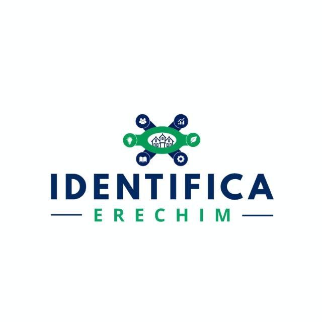

# Projeto Identifica

Projeto realizado pelo IFRS-Erechim, UFFS-Erechim e URI-Erchim em parceria com a Prefeitura da Cidade, visando elaborar um diagnóstico socioeconômico de Erechim.

Objetivo: Propor um modelo de atuação integrado para o município de Erechim, articulando diretrizes regionais, capacidades locais e mecanismos de monitoramento por indicadores, com foco na competitividade e no desenvolvimento sustentável.

# Identifica ETL

O repositório em questão (`identifica-etl`) contém a lógica de extração e integração dos dados em um banco de dados.

## Como rodar

Você vai precisar de `git` e `docker`.

1. Clone o repositório e acesse a pasta dele na sua máquina

```sh
git clone
```

2. Configure o `.env` com base no `.env.example`

3. Rodar

- No linux, rode o script `rodar.sh`

```sh
chmod +x rodar.sh
./rodar.sh
```

- No windows, rode o script `rodar.bat`

```powershell
.\rodar.bat
```
